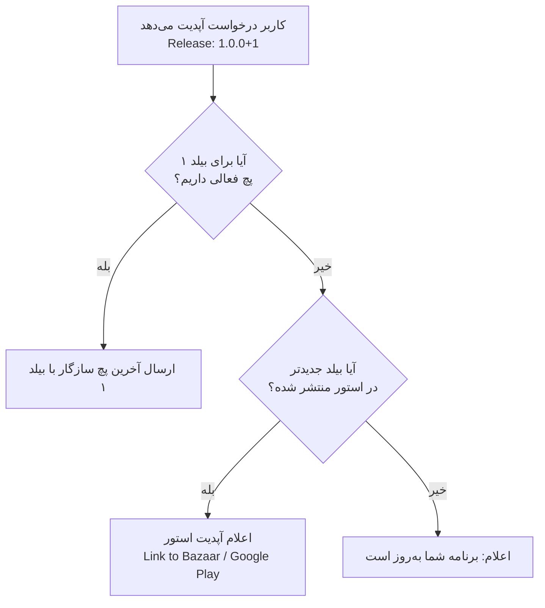

# سند جامع سیستم دیزاین و معماری هات‌آپدیت (Shorebird-Grade OTA Architecture)

این سند مرجع معماری برای بازطراحی و پایدارسازی زیرساخت به‌روزرسانی زنده (Over-The-Air Update) اپلیکیشن قرآن و تفکر است. هدف این طراحی، حذف ۱۰۰٪ خطای انسانی، پشتیبانی هم‌زمان از اپ‌باندل (AAB) و انواع APK، مدیریت چندنسخه‌ای کاربران و ارائه تجربه کاربری روان و امن است.

---

## ۱. چرایی شکنندگی سیستم فعلی (Root Cause & Anti-Patterns)

سیستم فعلی به دلایل زیر شکننده بود و نمی‌شد در مقیاس پروداکشن روی آن حساب باز کرد:
1. **وابستگی شدید به ورودی دستی در داشبورد:** ادمین باید نسخه، کد نسخه هدف، معماری سخت‌افزار و رشته ۳۲ کاراکتری MD5 را دستی تایپ می‌کرد. کوچک‌ترین اشتباه تایپی کل فرآیند را مختل می‌کرد.
2. **گره زدن پچ دارت به `versionCode` نیتیو گرادل:** گرادل در بیلد `--split-per-abi` به کدهای معماری عدد اضافه می‌کند (بیلد ۱ در ۶۴ بیتی تبدیل به ۲۰۰۱ می‌شود). تطابق عددی سخت‌گیرانه باعث خطای `targetVersionCode does not match` می‌شد.
3. **تک‌معماری بودن پچ‌ها:** برای هر پچ باید چندین بار خروجی گرفته می‌شد و چند فایل جداگانه آپلود می‌شد.

---

## ۲. پاسخ به مسئله چند بیلد: کاربر بیلد ۱ در برابر پچ بیلد ۲

### صورت مسئله:
> «من نسخه بیلد ۲ (مثلاً `1.0.1+2`) را داده‌ام و پچی برای بیلد ۲ منتشر می‌کنم. تکالیف کاربری که هنوز روی بیلد ۱ (`1.0.0+1`) است چیست؟»

### اصل طلایی معماری (Base Release Isolation):
پچ‌های کدهای دارت (`libapp.so`) **فقط روی کدهای نیتیو همان نسخه پایه (Base Release)** تضمین اجرا دارند. اگر در بیلد ۲ یک پکیج نیتیو (جاوا/کاتلین) جدید یا دسترسی جدیدی به `AndroidManifest.xml` اضافه شده باشد، کدهای دارت پچ بیلد ۲ روی بیلد ۱ به دلیل نبود کدهای نیتیو کرش خواهند کرد.

### مدیریت ۳ گانه سرور در قبال چند بیلد:



1. **تفکیک تاریخچه پچ‌ها در دیتابیس:**
   - هر پچ متعلق به یک **Base Release** است (`ForeignKey`). پچ نسخه `1.0.9` که برای بیلد ۲ کامپایل شده، **فقط و فقط** به دستگاه‌هایی داده می‌شود که بیلد پایه آن‌ها ۲ است.
2. **کاربر بیلد ۱ پچ بیلد ۲ را نمی‌گیرد:**
   کاربر بیلد ۱ هرگز پچ ناسازگار بیلد ۲ را دانلود نمی‌کند (تا از کرش جلوگیری شود).
3. **هدایت خودکار به استور (Store Update Fallback):**
   اگر کاربری روی بیلد ۱ باشد و شما دیگر برای بیلد ۱ پچ ندهید، سرور در پاسخ استعلام فلگ `status: STORE_UPDATE_REQUIRED` می‌فرستد و اپلیکیشن دیالوگ ارتقا از کافه‌بازار/گوگل‌پلی را به کاربر نشان می‌دهد تا فایل نصبی کامل بیلد ۲ را دریافت کند.

---

## ۳. مدیریت چندمعماری با اپ‌باندل (Multi-ABI Architecture)

هنگام انتشار اپ‌باندل (`AAB`)، گوگل‌پلی و کافه‌بازار به هر گوشی فقط فایل‌های پردازنده خودش را می‌دهند:
- گوشی‌های مدرن: `arm64-v8a`
- گوشی‌های قدیمی: `armeabi-v7a`
- شبیه‌سازها و پی‌سی: `x86_64`

### ساختار بسته پچ جامع (Unified Multi-ABI Bundle):
هنگام ساخت پچ، دولوپر با یک دستور یک پکیج تجمیعی تولید می‌کند که شامل تمام معماری‌هاست:
```text
patch_bundle_v2.zip
├── manifest.json
├── arm64-v8a/
│   ├── libapp.so
│   └── hash.txt
├── armeabi-v7a/
│   ├── libapp.so
│   └── hash.txt
└── x86_64/
    ├── libapp.so
    └── hash.txt
```

---

## ۴. طراحی قرارداد اندپوینت‌ها (API Contracts)

### اندپوینت ۱: استعلام آپدیت (`POST /api/v1/ota/check/`)

#### داده ارسالی از کلاینت فلاتر:
```json
{
  "app_id": "quran_tafakor",
  "base_release": "1.0.1+2",
  "base_version_name": "1.0.1",
  "base_build_number": 2,
  "abi": "arm64-v8a",
  "current_patch_version": "1.0.8",
  "channel": "stable",
  "device_id": "9b1deb4d-3b7d-4bad-9bdd-2b0d7b3dcb6d"
}
```

#### سناریوی الف: وجود پچ برای همین بیلد
```json
{
  "status": "PATCH_AVAILABLE",
  "patch": {
    "version": "1.0.9",
    "download_url": "https://api.domain.com/media/patches/quran_1.0.1+2_1.0.9_arm64.zip",
    "md5": "84db88c23d18d9e48080341fd4ea358e",
    "size_bytes": 4829100,
    "is_mandatory": false,
    "change_log": "بهبود دیالوگ ارسال به تاپیک و رفع اشکالات جزئی"
  }
}
```

#### سناریوی ب: کاربر روی بیلد قدیمی است و باید از استور آپدیت کند
```json
{
  "status": "STORE_UPDATE_REQUIRED",
  "store": {
    "latest_version": "1.0.1",
    "store_url": "bazaar://details?id=com.avapardaz.quran",
    "web_url": "https://cafebazaar.ir/app/com.avapardaz.quran",
    "is_mandatory": false,
    "message": "نسخه جدید قرآن در کافه‌بازار منتشر شده است. لطفاً برنامه را به‌روزرسانی کنید."
  }
}
```

#### سناریوی ج: بدون آپدیت
```json
{
  "status": "UP_TO_DATE",
  "message": "اپلیکیشن شما به‌روز است."
}
```

---

### اندپوینت ۲: گزارش وضعیت و تله‌متری (`POST /api/v1/ota/report/`)
```json
{
  "app_id": "quran_tafakor",
  "patch_version": "1.0.9",
  "event": "SUCCESS",
  "duration_ms": 380,
  "device_id": "9b1deb4d-3b7d-..."
}
```
* مقادیر ممکن `event`: `SUCCESS`, `MD5_FAILED`, `EXTRACT_FAILED`, `ROLLBACK_TRIGGERED`

---

## ۵. دیتابیس هوشمند جنگو (`models.py`)

```python
from django.db import models

class BaseRelease(models.Model):
    """نسخه‌های اصلی نصب‌شده از استور (مثلاً 1.0.0+1 یا 1.0.1+2)"""
    release_name = models.CharField(max_length=64, unique=True) # e.g. "1.0.1+2"
    build_number = models.PositiveIntegerField()               # e.g. 2
    version_string = models.CharField(max_length=32)           # e.g. "1.0.1"
    is_active = models.BooleanField(default=True)
    created_at = models.DateTimeField(auto_now_add=True)

class Patch(models.Model):
    """پچ‌های منتشر شده"""
    CHANNEL_CHOICES = [
        ('stable', 'عمومی (پایدار)'),
        ('beta', 'آزمایشی (تسترها)'),
    ]
    base_release = models.ForeignKey(BaseRelease, on_delete=models.CASCADE, related_name='patches')
    version = models.CharField(max_length=32) # e.g. "1.0.9"
    patch_number = models.PositiveIntegerField()
    channel = models.CharField(max_length=16, choices=CHANNEL_CHOICES, default='stable')
    is_active = models.BooleanField(default=True)
    change_log = models.TextField(blank=True)
    created_at = models.DateTimeField(auto_now_add=True)

class PatchArtifact(models.Model):
    """فایل‌های باینری به ازای هر معماری سخت‌افزار"""
    ABI_CHOICES = [
        ('arm64-v8a', 'ARM 64-bit'),
        ('armeabi-v7a', 'ARM 32-bit'),
        ('x86_64', 'x86_64'),
    ]
    patch = models.ForeignKey(Patch, on_delete=models.CASCADE, related_name='artifacts')
    abi = models.CharField(max_length=32, choices=ABI_CHOICES)
    file = models.FileField(upload_to='ota_patches/')
    md5 = models.CharField(max_length=32)
    file_size = models.PositiveIntegerField()
```

---

## ۶. فرآیند آپلود بدون ورودی دستی در سرور (Zero-Input Upload)

در پنل ادمین جنگو، ادمین فقط **یک فایل پکیج زیپ چندمعماری** را انتخاب می‌کند:
1. متد `save` جنگو فایل زیپ را باز می‌کند.
2. `manifest.json` درون زیپ را می‌خواند (`base_release` و `version`).
3. پوشه‌های `arm64-v8a` و `armeabi-v7a` و `x86_64` را جدا کرده و در `PatchArtifact` ذخیره می‌کند.
4. هش MD5 هر فایل را خودش با کتابخانه `hashlib` پایتون محاسبه می‌کند.
5. **نتیجه:** صفر درصد خطای انسانی در تایپ کردن اطلاعات!

---

## ۷. ایمنی و بازگشت خودکار در صورت کرش (Auto-Rollback / Crash Guard)

اگر پچ جدید بعد از دانلود و نصب، روی برخی دستگاه‌ها خطای زمان اجرا بدهد و کرش کند:
1. **شمارنده سلامت بوت (Boot Health Counter):**
   - به محض اجرای اپلیکیشن: `crashCount` در حافظه محلی یکی اضافه می‌شود.
   - اگر صفحه اصلی موفق لود شد و ۳ ثانیه بدون کرش کار کرد: `crashCount = 0` می‌شود.
2. **شرط رول‌بک اضطراری:**
   - اگر اپلیکیشن قبل از ۳ ثانیه بسته شود و در استارت بعدی ببیند `crashCount >= 2`:
     1. پچ جاری بلافاصله غیرفعال و فایل‌های آن حذف می‌شوند.
     2. اپلیکیشن با کدهای سالم اولیه (`libapp.so` اصلی) لود می‌شود.
     3. رویداد `ROLLBACK_TRIGGERED` به سرور گزارش می‌شود تا ادمین متوجه شود.
   - **دستاورد:** کاربر هرگز در حلقه کرش گیر نمی‌افتد و برنامه بریک (Brick) نمی‌شود.

---

## ۸. تجربه کاربری: دانلود خاموش در پس‌زمینه (Silent Background Update)

در استاندارد Shorebird، کاربر هرگز معطل دیالوگ‌های سنگین لودینگ نمی‌شود:
1. **لود آنی اپلیکیشن:** اپلیکیشن بلافاصله با کدهای موجود باز شده و کاربر بدون تاخیر با قرآن کار می‌کند.
2. **استعلام و دانلود بی‌صدا:**
   - در پس‌زمینه استعلام گرفته می‌شود.
   - اگر پچ جدیدی بود، بی‌صدا در پس‌زمینه دانلود شده و بررسی MD5 انجام می‌شود.
3. **اعمال تغییرات:**
   - پچ در دایرکتوری ذخیره شده و برای باز شدن بعدی اپلیکیشن علامت‌گذاری می‌شود.
   - در صورت تمایل، یک اسنک‌بار ملایم و غیرمزاحم در پایین صفحه نشان داده می‌شود:
     *«نسخه جدید آماده است. برای اعمال، برنامه را مجدداً باز کنید.»* با دکمه *«راه‌اندازی مجدد»*.

---

## ۹. کانال‌های انتشار (`Release Channels: stable / beta`)

برای جلوگیری از ارسال پچ تست‌نشده به دست همه کاربران:
1. **تعریف کانال‌ها در سرور:**
   - کانال `beta`: مخصوص گوشی‌های توسعه‌دهنده و تسترها.
   - کانال `stable`: مخصوص عموم کاربران.
2. **روند انتشار امن:**
   - هنگام انتشار اولیه، پچ با کانال `beta` ثبت می‌شود.
   - پس از تست میدانی و اطمینان از عملکرد، در پنل سرور با یک کلیک وضعیت آن به `stable` ارتقا می‌یابد تا همه کاربران آن را دریافت کنند.

---

## ۱۰. اتوماسیون انتشار با یک دستور در ترمینال (`CLI Tool`)

به جای ورود به مرورگر، یک اسکریپت پایتون/دارت در ریشه پروژه (`tool/publish_patch.py`) تمامی مراحل را با یک دستور انجام می‌دهد:

```bash
python tool/publish_patch.py --version 1.0.9 --channel stable
```

### وظایف خودکار اسکریپت:
1. اجرای بیلد ریلیز کدهای فلاتر.
2. استخراج فایل‌های `libapp.so` برای هر ۳ معماری (`arm64-v8a`, `armeabi-v7a`, `x86_64`).
3. ایجاد `manifest.json` و فشرده‌سازی در قالب `patch_bundle.zip`.
4. ارسال مستقیم فایل زیپ با متد `POST multipart/form-data` به اندپوینت `/api/v1/ota/publish/` با توکن احراز هویت.
5. دریافت پاسخ تایید سرور و نمایش نتیجه در ترمینال در کمتر از چند ثانیه.

---

## ۱۱. چک‌لیست و مراحل پیاده‌سازی گام‌به‌گام

| مرحله | بخش | اقدام مشخص |
| :---: | :--- | :--- |
| **۱** | **بک‌اند (جنگو)** | ایجاد مدل‌های `BaseRelease`، `Patch` و `PatchArtifact` طبق مستند |
| **۲** | **بک‌اند (جنگو)** | افزودن منطق بازکردن خودکار زیپ و محاسبه MD5 در متد `save` ادمین |
| **۳** | **بک‌اند (جنگو)** | پیاده‌سازی اندپوینت استاندارد `/api/v1/ota/check/` با پشتیبانی از چند بیلد و استور |
| **۴** | **کلاینت (فلاتر)** | اصلاح `OtaUpdateController` برای ارسال `abi` و پیاده‌سازی مکانیزم Crash Guard |
| **۵** | **ابزار (CLI)** | ساخت اسکریپت `tool/publish_patch.py` جهت انتشار مستقیم با یک دستور |
