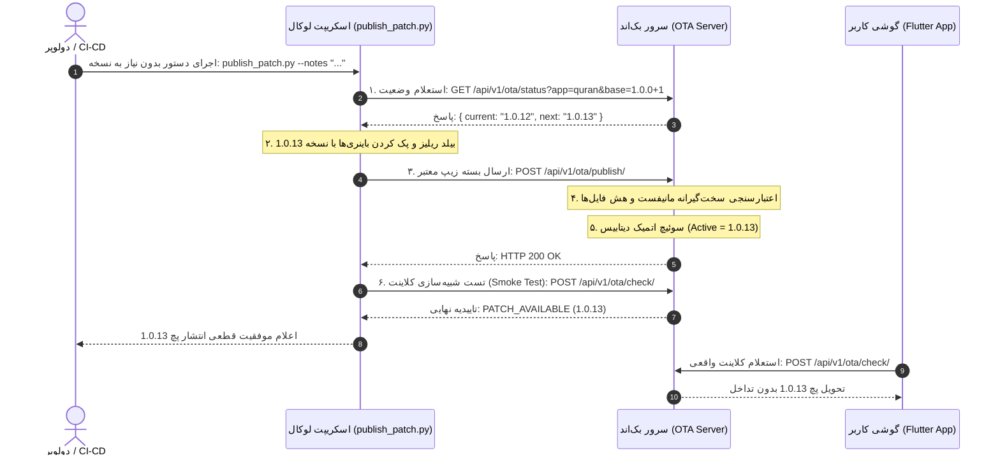

# سند نیازمندی‌ها و بازطراحی اصولی پایپ‌لاین OTA (Server-Driven OTA RFC)

این سند فنی جهت بازطراحی، امن‌سازی و خودکارسازی کامل چرخه حیات پچ‌های OTA بین سرور و اسکریپت CLI تهیه شده است تا در فاز توسعه بک‌اند پیاده‌سازی و نهایی شود.

---

## ۱. چرایی بازطراحی (Post-Mortem & Motivation)

در نسخه ۱۲ پچ، کلاینت پس از دریافت پچ موقت `1.0.1` به دلیل باگ‌های زیر وارد حلقه «برنامه به آخرین نسخه مجهز است» شد:
1. **دوگانگی ساختار بک‌اند (Split Brain):** وجود دو سیستم و دو جدول دیتابیس مجزا (اندپوینت لگسی داشبورد `/api/patches/upload` و اندپوینت جدید `/api/v1/ota/publish/`). آپدیت شدن یکی، دیگری را مطلع نمی‌کرد.
2. **پذیرش فایل‌های ناقص توسط سرور:** ارسال زیپ تستی بدون `manifest.json` به جای خطای ۴۰۰، سرخود نسخه `1.0.1` را در دیتابیس ایجاد و فعال کرد.
3. **تعیین دستی نسخه توسط انسان:** احتمال خطای انسانی در تایپ شماره نسخه یا فراموشی آخرین نسخه فعال در سرور.
4. **فعال‌سازی غیراتمیک:** تغییر وضعیت به `Active` پیش از اعتبارسنجی سلامت کامل باینری‌ها روی دیسک سرور.

---

## ۲. اصول طلایی معماری جدید (Core Principles)



### اصل اول: منبع حقیقت واحد (Single Source of Truth)
- تمام جداول دیتابیس پچ‌ها باید یکی شوند (`Patch` و `PatchArtifact`).
- اندپوینت‌های لگسی (مانند `GET /check` و `POST /api/patches/upload`) نباید جدول مستقل داشته باشند؛ بلکه باید صرفاً یک View/Adapter ساده به همان مدل‌های اصلی باشند.

### اصل دوم: استعلام نسخه بعدی توسط سرور (Server-Driven Version Discovery)
- نسخه پچ باید قبل از کامپایل مشخص باشد (چون درون باینری `libapp.so` هاردکد می‌شود).
- اسکریپت قبل از بیلد، از اندپوینت `/api/v1/ota/status` می‌پرسد: *«نسخه فعال چیست؟»*
- سرور آخرین نسخه را نگاه کرده و شماره پچ بعدی را یک واحد افزایش می‌دهد (`Auto-Increment Patch`).

### اصل سوم: اعتبارسنجی سفت‌وسخت در نطفه (Strict Invariants)
- نبود فایل `manifest.json` ⬅️ **HTTP 400 Bad Request**.
- عدم تطابق هش MD5 اعلام‌شده در مانیفست با بایت‌های دریافتی ⬅️ **HTTP 422 Unprocessable Entity**.
- کمتر یا مساوی بودن شماره نسخه با نسخه فعال قبلی ⬅️ **HTTP 409 Conflict**.

### اصل چهارم: سوئیچ اتمیک و بدون قطعی (Atomic Cutover)
- تا زمانی که فایل زیپ به صورت کامل در پوشه مقصد Unzip نشده و فایل‌های `libapp.so` چک نشده‌اند، رکورد جدید فعال نمی‌شود.
- عملیات دیتابیس در یک تراکنش اتمیک (`transaction.atomic`) انجام می‌شود: نسخه قبلی آرشیو و نسخه جدید فعال می‌شود.

### اصل پنجم: تست سلامت خودکار (CLI Smoke Test)
- اسکریپت بلافاصله بعد از آپلود، یک درخواست تستی به عنوان یک گوشی واقعی به سرور می‌زند و مطمئن می‌شود سرور پچ را با کد ۲۰۰ تحویل می‌دهد.

---

## ۳. قرارداد اندپوینت‌های جدید بک‌اند (API Specs)

### ۱. استعلام وضعیت و پیشنهاد نسخه بعدی
- **متد:** `GET /api/v1/ota/status/`
- **پارامترها:**
  - `app_id` (اجباری): `quran_tafakor`
  - `base_release` (اجباری): `1.0.0+1`
  - `channel` (اختیاری): `stable` (پیش‌فرض)
- **پاسخ موفق (HTTP 200):**
```json
{
  "ok": true,
  "app_id": "quran_tafakor",
  "base_release": "1.0.0+1",
  "channel": "stable",
  "active_patch": {
    "version": "1.0.12",
    "patch_number": 12,
    "size_bytes": 4724185,
    "created_at": "2026-10-13T10:56:53Z"
  },
  "next_suggested_version": "1.0.13"
}
```

---

### ۲. انتشار بسته پچ با اعتبارسنجی اتمیک
- **متد:** `POST /api/v1/ota/publish/`
- **نوع داده:** `multipart/form-data`
- **فیلدها:**
  - `channel`: `stable` یا `beta`
  - `bundle`: فایل زیپ پچ
- **منطق پردازش در بک‌اند:**
```python
# شبه‌کد نمایشی برای views.py در بک‌اند جنگو:
from django.db import transaction
import zipfile, json, hashlib

@transaction.atomic
def publish_patch_view(request):
    bundle_file = request.FILES.get('bundle')
    channel = request.POST.get('channel', 'stable')
    
    # ۱. اعتبارسنجی زیپ
    try:
        zf = zipfile.ZipFile(bundle_file)
    except Exception:
        return JsonResponse({"ok": False, "error": "فایل زیپ نامعتبر است."}, status=400)
    
    # ۲. اعتبارسنجی مانیفست
    if 'manifest.json' not in zf.namelist():
        return JsonResponse({"ok": False, "error": "فایل manifest.json در ریشه پکیج الزامی است."}, status=400)
        
    manifest = json.loads(zf.read('manifest.json').decode('utf-8'))
    app_id = manifest.get('app_id')
    version = manifest.get('version')
    base_release = manifest.get('base_release')
    artifacts = manifest.get('artifacts', {}) # dict of abi -> {md5, size_bytes, target_code}
    
    # ۳. اعتبارسنجی نسخه صعودی
    latest_patch = Patch.objects.filter(base_release__release_name=base_release, channel=channel, is_active=True).first()
    if latest_patch and compare_semver(version, latest_patch.version) <= 0:
        return JsonResponse({"ok": False, "error": f"نسخه ارسالی ({version}) باید بزرگتر از نسخه فعال ({latest_patch.version}) باشد."}, status=409)
        
    # ۴. اعتبارسنجی بایت‌های آرتیفکت‌ها و ذخیره‌سازی
    # ... استخراج به دیسک و محاسبه هش ...
    
    # ۵. سوئیچ اتمیک
    if latest_patch:
        latest_patch.is_active = False
        latest_patch.save(update_fields=['is_active'])
        
    new_patch = Patch.objects.create(
        base_release=base_rel_obj,
        version=version,
        channel=channel,
        is_active=True,
        change_log=manifest.get('change_log', '')
    )
    return JsonResponse({"ok": True, "version": version, "patch_id": new_patch.id})
```

---

## ۴. طراحی اسکریپت آینده (`publish_patch.py`)

با پیاده‌سازی این معماری، دولوپر دیگر هیچ عددی را به خاطر نمی‌سپارد:

```bash
# بدون وارد کردن دستی نسخه:
python tool/publish_patch.py --notes "اصلاح تایمر خواب" --server http://5.22.203.61
```

اسکریپت:
1. ابتدا از سرور استعلام می‌گیرد و نسخه `1.0.13` را دریافت می‌کند.
2. پروژه را برای نسخه `1.0.13` پک می‌کند.
3. فایل را به اندپوینت واحد ارسال می‌کند.
4. تست سلامت (Smoke Test) کلاینت را اجرا کرده و گزارش نهایی را پرینت می‌کند.

---

## ۵. چک‌لیست تسک‌های اجرایی (Action Items)

| اولویت | بخش | تسک مشخص |
| :---: | :--- | :--- |
| 🔴 **بالا** | **بک‌اند** | تجمیع مدل‌های پچ به یک جدول واحد و حذف سیستم دوگانه (`models.py`) |
| 🔴 **بالا** | **بک‌اند** | اضافه کردن اعتبارسنجی سخت‌گیرانه برای رد پکیج‌های فاقد `manifest.json` |
| 🟡 **متوسط** | **بک‌اند** | ایجاد اندپوینت `GET /api/v1/ota/status/` برای اعلام خودکار نسخه بعدی |
| 🟡 **متوسط** | **بک‌اند** | پیاده‌سازی تراکنش اتمیک (`transaction.atomic`) هنگام تغییر وضعیت پچ‌ها |
| 🟢 **عادی** | **اسکریپت CLI** | آپدیت `publish_patch.py` برای استعلام خودکار نسخه و تست سلامت نهایی |
